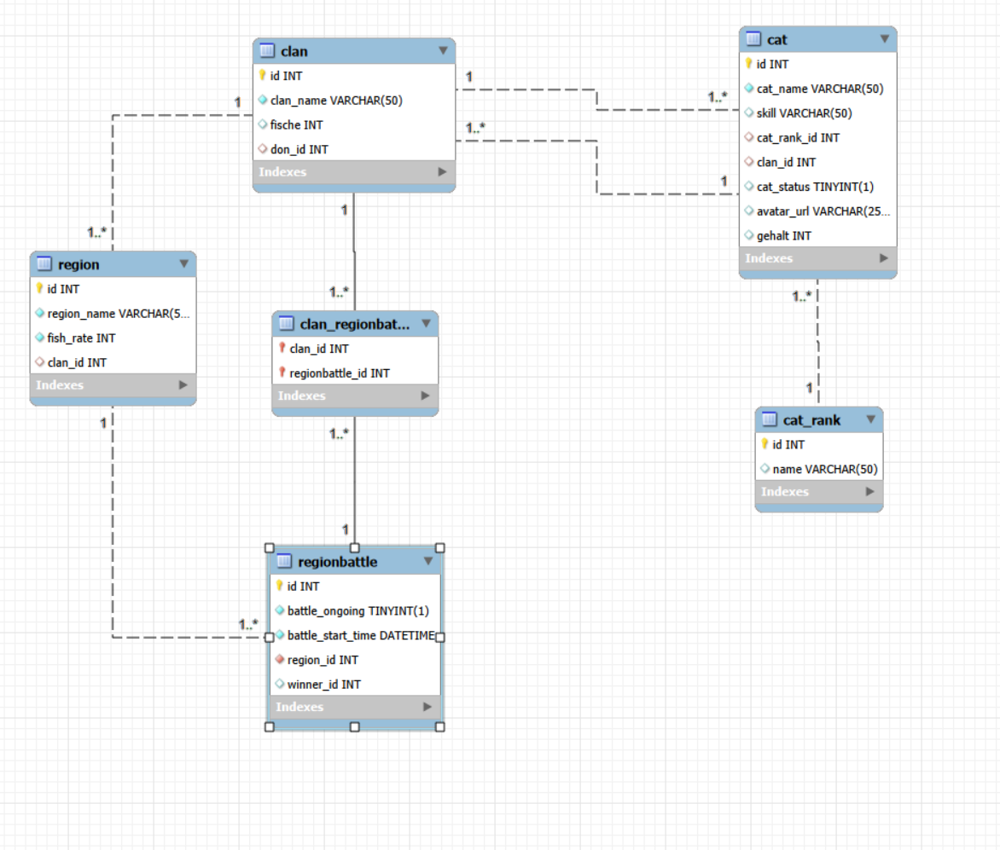

# 🐾 Cat Mafia

**Good Cats, Bad Business.**

Cat Mafia ist eine kleine Fullstack-Webanwendung. Katzen-Clans werben Streuner an, erobern Regionen und kämpfen um die besten Fischgründe.

## Funktionen

| Seite | Datei | Was man dort macht |
|---|---|---|
| Mitglieder | `frontend/index.html` | Alle Katzen mit Bild, Rang, Spezialgebiet und Status (aktiv/inaktiv) |
| Neues Mitglied | `frontend/indexZwei.html` | Neue Katze anlegen, mit Bildvorschau |
| Clan Area | `frontend/clanArea.html` | Alle Clans mit Don, Fischen, Gebieten und Mitgliedern. Mit „Wählen“ spielt man mit diesem Clan |
| Neuer Clan | `frontend/clanAnlegen.html` | Neuen Clan mit eigenem Don anlegen |
| Streuner Markt | `frontend/streunerKatzen.html` | Katzen ohne Clan für Fische rekrutieren |
| Regionen | `frontend/regionen.html` | Freie Regionen übernehmen oder einen Kampf um eine besetzte Region starten |

### Spielregeln

- **Rekrutieren:** Eine Katze kostet ihr Gehalt in Fischen. Hat der Clan zu wenig Fische, klappt es nicht.
- **Freie Region:** Wird sofort vom gewählten Clan übernommen.
- **Besetzte Region:** Es beginnt ein Kampf. Der angreifende Clan braucht mindestens 10 Fische und 2 Mitglieder.
- **Kampfergebnis:** Fische plus Gehälter aller aktiven Mitglieder werden verglichen. Beide Clans verlieren 10 Fische und je eine zufällige Katze wird inaktiv. Bei Gleichstand gewinnt der Verteidiger.

## Technik

- **Frontend:** HTML, CSS, JavaScript (fetch, DOM)
- **Backend:** Node.js, Express 5, Schichtenmodell (Router → Controller → Service → Repository)
- **Datenbank:** MySQL mit `mysql2` (Connection Pool, Transaktionen, Platzhalter gegen SQL-Injection)
- **Weitere Pakete:** cors, cookie-parser, nodemon, Jest

## Ordnerstruktur

```
Katzen_mafia/
├── backend_db/
│   ├── index.js                  Startpunkt des Servers
│   ├── .env.example              Vorlage für die Zugangsdaten
│   ├── cat.repostiory.test.js    Jest-Test
│   └── src/
│       ├── router/               Welche URL zu welcher Funktion führt
│       ├── controller/           Anfrage lesen, Antwort senden
│       ├── service/              Regeln der Anwendung
│       ├── repositories/         SQL-Abfragen
│       └── util/db.js            Verbindung zur Datenbank
├── database/
│   └── mafiacats.sql             Tabellen, Beziehungen und Startdaten
├── docs/
│   └── datenbank-diagramm.png    ER-Diagramm
└── frontend/                     HTML-, CSS- und JS-Dateien, Bilder
```

## Installation

### Voraussetzungen

- Node.js (Version 22 oder neuer)
- MySQL 8
- VS Code mit der Erweiterung **Live Server**

### 1. Datenbank anlegen

PowerShell im Projektordner öffnen:

```powershell
mysql -u root -p
```

In MySQL:

```sql
SOURCE database/mafiacats.sql;
```

Das Skript löscht eine vorhandene Datenbank `mafiacats` und legt sie neu an.

### 2. Backend einrichten

```powershell
cd backend_db
npm install
copy .env.example .env
```

In `.env` das eigene MySQL-Passwort bei `DB_PASSWORD` eintragen.

### 3. Backend starten

```powershell
npm run dev
```

Der Server läuft auf `http://127.0.0.1:6767`.

### 4. Frontend starten

Den Ordner `Katzen_mafia` in VS Code öffnen, `frontend/index.html` mit **Live Server** starten und im Browser aufrufen:

```
http://127.0.0.1:5500/frontend/index.html
```

> Das Backend erlaubt nur Anfragen von `http://127.0.0.1:5500` (CORS). Bitte `127.0.0.1` benutzen, nicht `localhost`.

### 5. Tests

```powershell
cd backend_db
npm test
```

## API

Basis-URL: `http://127.0.0.1:6767/api`

| Methode | Pfad | Beschreibung |
|---|---|---|
| GET | `/cat` | Alle Katzen mit Rang |
| POST | `/cat` | Neue Katze anlegen (`name`, `avatar_url`) |
| PUT | `/cat/:id` | Katze für den gewählten Clan rekrutieren |
| GET | `/clan` | Alle Clans mit Don, Anzahl Regionen und Mitglieder |
| GET | `/clan/set/:id` | Clan wählen (setzt das Cookie `clan`) |
| POST | `/clan/new` | Neuen Clan mit Don anlegen |
| GET | `/region` | Alle Regionen mit Herrscher und laufendem Kampf |
| PUT | `/region/:id` | Region übernehmen oder Kampf starten |
| PUT | `/region/gewinner/:id` | Kampf auswerten und Gewinner bestimmen |

Für `PUT /cat/:id` und die Regionen muss vorher ein Clan gewählt sein, weil das Backend den Clan aus dem Cookie liest.

## Datenbank



| Tabelle | Inhalt | Beziehungen |
|---|---|---|
| `cat_rank` | Ränge von Straßenkater (1) bis Don (10) | – |
| `cat` | Katzen | `cat_rank_id` → `cat_rank`, `clan_id` → `clan` (NULL = Streuner) |
| `clan` | Clans | `don_id` → `cat` |
| `region` | Regionen | `clan_id` → `clan` (NULL = frei) |
| `regionbattle` | Kämpfe um eine Region | `region_id` → `region`, `winner_id` → `clan` |
| `clan_regionbattle` | Welche Clans an einem Kampf teilnehmen (n:m) | `clan_id` → `clan`, `regionbattle_id` → `regionbattle` |

## Bekannte Einschränkungen

- Neue Mitglieder bekommen immer den Rang Straßenkater. Rang und Spezialgebiet aus dem Formular werden noch nicht gespeichert.
- Die Katzenbilder kommen von `mafiacats.onrender.com` und wiederholen sich.
- Die Adressen von Backend und Frontend sind fest im Code eingetragen.

## Autor

[adnanDevo](https://github.com/adnanDevo)
